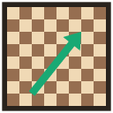

# Chess Coach

Расширение для Chrome, которое разбирает позицию на доске chess.com или lichess.org
движком **Stockfish 19** и показывает лучшие ходы стрелками прямо поверх доски.
Силу движка можно задать ползунком — от новичка на 500 Эло до полной силы.

Движок работает локально, в WebAssembly: ничего никуда не отправляется, интернет после установки не нужен.



---

## Возможности

- **Регулируемая сила.** Ползунок 500 – 3200 Эло и готовые пресеты («Новичок», «Клубный», «Гроссмейстер», «Максимум»).
- **Стрелки на доске.** До пяти вариантов разными цветами, первый — толще остальных, с подписью хода и оценки.
- **Несколько вариантов (MultiPV).** Боковая панель показывает оценку, ход и продолжение каждого варианта.
- **Сравнение с идеалом.** На ограниченной силе движок намеренно ошибается — можно включить показ объективно лучшего хода рядом.
- **Точный FEN.** Позиция собирается по списку ходов партии, поэтому рокировки, взятие на проходе и счётчики ходов верны.
- **Ручной ввод.** Любой FEN можно вставить в панель и посчитать отдельно.
- **Фильтр по стороне.** Подсказывать можно только за белых, только за чёрных или за обе стороны.

---

## Установка

Расширения нет в Chrome Web Store — оно ставится из исходников.

1. Скачайте или склонируйте репозиторий.
2. Откройте `chrome://extensions/`.
3. Включите **Режим разработчика** (переключатель в правом верхнем углу).
4. Нажмите **Загрузить распакованное расширение** и выберите папку репозитория.

Нужен Chrome 116 или новее (из-за Side Panel API и `chrome.runtime.getContexts`).

## Как пользоваться

1. Откройте партию, задачу или анализ на chess.com либо lichess.org.
2. Нажмите на иконку расширения — справа откроется панель.
3. Выставьте силу движка. Дальше каждый ход на доске считается автоматически.

Если доска не определилась, в панели появится подсказка. Позицию всегда можно
посчитать вручную: скопировать FEN в поле панели и нажать «Анализировать этот FEN».

---

## Как устроено

Manifest V3 запрещает долгие вычисления в service worker: он выгружается через
секунды простоя. Поэтому движок живёт в **offscreen-документе** — невидимой
странице, у которой нормальный жизненный цикл и доступ к Web Workers.

```
┌──────────────────┐   снимок доски    ┌────────────────┐   FEN + настройки  ┌──────────────────┐
│  content script  │ ────────────────▶ │ service worker │ ─────────────────▶ │ offscreen-страница│
│   (вкладка)      │                   │  (маршрутизатор)│                   │   Stockfish WASM │
│  читает DOM,     │ ◀──────────────── │                │ ◀───────────────── │   в Web Worker   │
│  рисует стрелки  │     стрелки       └────────────────┘     варианты       └──────────────────┘
└──────────────────┘                          ▲    │
                                    состояние │    │ настройки
                                              │    ▼
                                      ┌──────────────────┐
                                      │   боковая панель │
                                      └──────────────────┘
```

Роли разделены жёстко: content script знает только про DOM сайта, offscreen —
только про шахматы, service worker — только про маршрутизацию. Ни один из них
не знает, как устроены остальные.

### Как читается позиция

Два источника, от точного к приблизительному:

1. **Список ходов партии.** Ходы переигрываются от начальной позиции библиотекой
   `chess.js` — получается безупречный FEN. Список обрезается по выделенному ходу,
   поэтому перемотка партии назад тоже работает.
2. **Расстановка фигур.** Если списка нет (задачи, расставленная вручную позиция,
   изменившаяся вёрстка сайта) — поля читаются из DOM. Права рокировки тогда
   оцениваются по положению короля и ладей, взятие на проходе — по последнему ходу.
   Панель честно помечает такую позицию как приблизительную.

Очередь хода определяется по чётности списка ходов, по работающим часам игрока или
сравнением с предыдущим снимком доски. Если позиция при выбранной стороне невозможна
(например, король не ходящей стороны стоит под шахом) — сторона меняется автоматически.
Переключить её вручную можно в панели.

### Как задаётся сила

Stockfish умеет ограничивать себя сам, но его собственный минимум — около 1320 Эло.
Ниже этой границы слабая игра имитируется, как это делает lichess:

| Выбрано в панели | Что получает движок                                       |
| ---------------- | --------------------------------------------------------- |
| 500 – 1310       | `UCI_LimitStrength false`, `Skill Level` 0–7, глубина 1–6   |
| 1320 – 3190      | `UCI_LimitStrength true`, `UCI_Elo` = выбранному значению   |
| МАКС             | ограничения сняты, полная сила в пределах заданного времени |

Границы не захардкожены: они читаются из ответа движка на команду `uci`, так что
при замене сборки Stockfish всё подстроится само.

---

## Разработка

```bash
npm test        # 37 проверок: шахматная логика, разбор UCI, целостность сборки
npm run pack    # собрать dist/chess-coach.zip для публикации
```

Сборки нет — расширение грузится в Chrome как есть. Зависимостей в рантайме тоже
нет: `chess.js` и Stockfish лежат в репозитории.

### Структура

```
manifest.json
src/
  common/protocol.js      общий протокол сообщений и значения по умолчанию
  common/strength.js      перевод «рейтинг → настройки UCI»
  background/             service worker: маршрутизация, жизненный цикл движка
  offscreen/uci.js        обёртка над движком, говорящая на UCI
  offscreen/position.js   снимок доски → FEN, UCI → шахматная нотация
  offscreen/offscreen.js  хост движка
  content/adapters.js     чтение доски: chess.com и lichess
  content/overlay.js      отрисовка стрелок (SVG поверх доски)
  content/content.js      слежение за доской
  panel/                  боковая панель
  engine/                 Stockfish 19 lite, однопоточный WASM (~1,8 МБ)
  vendor/chess.js         правила шахмат
test/                     тесты
```

Поддержка нового сайта — это один объект в `src/content/adapters.js` с методами
`findBoard`, `orientation`, `readPieces`, `readMoves`, `lastMove` и `turnFromClock`.
Остальной код трогать не нужно.

---

## Лицензии

Проект распространяется по **GPL-3.0-or-later**: в составе поставляется Stockfish,
а это копилефт-лицензия.

| Компонент | Лицензия | Файл |
| --------- | -------- | ---- |
| Stockfish 19 (WASM-сборка [stockfish.js](https://github.com/nmrugg/stockfish.js)) | GPL-3.0 | [`licenses/stockfish-GPL-3.0.txt`](licenses/stockfish-GPL-3.0.txt) |
| [chess.js](https://github.com/jhlywa/chess.js) | BSD-2-Clause | [`licenses/chess.js-BSD-2-Clause.txt`](licenses/chess.js-BSD-2-Clause.txt) |

---

## О честной игре

Инструмент сделан для разбора позиций, работы над своими партиями и тренировки.
Подсказки движка в идущей рейтинговой партии нарушают правила честной игры
chess.com и lichess.org и ведут к блокировке аккаунта.
